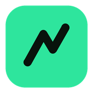

# Entryvex™

**Live market research for crypto and stocks worldwide: know when a trade is worth taking, and when it isn't.**
*Built for day traders, swing traders, market analysts and long-term holders.*

### [**▶ Open Entryvex at entryvex.trade**](https://entryvex.trade)

---

## Why Entryvex

Most trading tools tell you what *might* happen. Entryvex tells you **what actually happened the last time**: every signal is backed by a measured track record on that exact market, after fees, and Entryvex says **"don't trade"** when the numbers aren't on your side.

| | |
|---|---|
| 🎯 **One clear answer** | *Entryvex says*: **BUY**, **WAIT**, **DON'T BUY**, **HOLD** or **SELL NOW**, in plain English. |
| 📏 **Measured, not guessed** | Confidence comes from replaying every past occurrence of a setup, with a statistical test so luck doesn't count as skill. |
| 💵 **Sized to your money** | Exactly how much to buy, where to take profit, where to cut the loss, and when to sell by. |
| 🟢 **Simple mode** | Click a coin or stock and get one big answer, **BUY / SELL / WAIT**, with why, how much, where to take profit and cut the loss, and what the bot is doing there. Switch to **Pro** for every tool. |
| ☀️ **Today** | A one-screen daily brief: market mood (crypto fear & greed, VIX, how BTC and the S&P are doing), which of your markets has a buy signal right now (or which setups are closest), what to do with what you own, what the bot did, and earnings or big US economic news coming up. |
| 🎮 **Practice account** | Press **Practice this trade** on any BUY signal and Entryvex buys it with pretend money in a $1,000 practice account at the live price, then sells it by the plan (its trailing stop). See how following the signals goes before risking real money. Kept separate from your real trades and the daily loss guard. |
| 💼 **My holdings** | Add what you own (how many, price paid). For each one Entryvex says **buy more, hold or trim**, with a sized amount and a price alert to act at. A portfolio check flags too much in one market or in crypto, and estimates what a bad month could cost. |
| 📖 **Trading words explained** | Words like stop-loss, take-profit, OCO, limit order, VIX or "after fees" have a dotted underline. Hover or tap one for a one-sentence explanation. |
| 🤖 **Paper-trading bot** | Trades a virtual $100 across 12 markets (BTC, ETH, SOL, XRP, DOGE, SPY, QQQ, Apple, NVIDIA, Tesla, Microsoft, Amazon) 24/7 at live prices with fees, following the trend rule: buys daily breakouts in uptrends, sells with a trailing stop, risks 1% per trade, skips and exits around earnings. Publishes its full record. Follow it to get its trades as alerts. No real money. |
| 📏 **Forecast scorecard** | Every forecast for those 12 markets is saved before it happens and checked after: how often price really landed inside the 80% range, and whether the up/down lean beat a coin flip. Misses count the same as hits, and the latest checks are listed. Until the live record builds up, it shows the same forecast tested on past data (using only the candles before each moment). |
| 📈 **One tested BUY rule** | BUY answers come only from the **trend rule** on daily charts: a market in an uptrend (above its 200-day average, 50-day above the 200-day) closes at a new 20-day high; sell with a trailing stop (2 ATR, then 3 ATR under the highest price since buying), no fixed target. The earlier short-term setups lost money on unseen data, so they're kept as research only. |
| 🛡️ **Protective stops for holdings** | Every holding gets the same exit the trend rule uses (3 ATR under the 22-day high), with a one-tap alert, so long-term holders can choose to avoid riding a crash all the way down. |
| 📡 **Trend radar** | The trend rule also runs on 40 popular coins, stocks and ETFs that aren't on your watchlist (a few times a day), so BUY signals elsewhere show up in Opportunities and Today. |
| 🧪 **Tested on unseen data** | `npm run walkforward` replays the trend rule on the 40 radar markets (2020–2026), moment by moment, after fees, next to the same trades at random moments and to just holding. Latest: +0.96% per trade over 791 trades; random entries with the same trailing stop made +0.87%, so the exit does the work, not the timing. Worst drops were smaller than holding in 37 of 39 markets (median 22% vs 44%), but holding earned much more in rising markets. All of it, including the weak parts, is in the Scorecard tab and under every BUY. |
| ⭐ **Stock picks** | Entryvex Stock Rank: a monthly momentum, trend and low-volatility ranking of 100 large US stocks, with an 18-year after-cost track record vs the S&P 500. |
| 🌍 **Global** | World indices, gold, oil, currencies, yields and the economic calendar; stocks from the US, Europe, Asia and the Americas. |
| 🔔 **Alerts, even when closed** | Price, big-move, buy-setup and SELL alerts on your phone or computer. |
| 🔒 **Private** | No accounts, no tracking, no ads. Your settings and trades stay in your browser. |

---

## Get started in 60 seconds

1. Open **[entryvex.trade](https://entryvex.trade)** on your phone or computer.
2. Choose your style at the top: **⚡ Day trader**, **📅 Swing trader** or **🏦 Long-term holder**.
3. Pick a coin or stock from the watchlist, or search for one (*Bitcoin*, *Apple*, *SPY*, *Toyota*, *SAP*…).
4. Read **Entryvex says** under the chart.
5. Enter your trading balance and the most you'll risk per trade (1% is a good start).
6. Tap **🔔** → **Turn on closed-app alerts**, so Entryvex can tell you when it's time to buy or sell.

> **Tip:** Install it like an app: *Add to Home Screen* on your phone, or **⬇ Install app** in Chrome/Edge.

---

## Features

<b>📈 Markets & live data</b>

- **Trading style switch:** Day trader (5-minute candles, fast signals first), Swing trader (4-hour), Long-term holder (daily, long-term view first). The watchlist re-checks every market on the candle size you choose.
- **Chart:** 1m to 1D candles plus 1Y / 5Y / ALL views; drag to move, Ctrl + mouse wheel to zoom; hover any candle for its prices, change and amount traded.
- **Candlestick patterns:** hammer, engulfing, piercing line, morning/evening star, three white soldiers / black crows, harami, shooting star, hanging man, doji and more, marked on the chart. Each is measured on the market and candle size you're viewing; bullish ones are tested as buy setups and only become a BUY when their record here is proven.
- **Crypto:** every Binance.US pair, streamed live 24/7.
- **Stocks & ETFs worldwide:** US (NYSE/Nasdaq) plus London, Frankfurt, Paris, Amsterdam, Zurich, Tokyo, Hong Kong, Shanghai, Seoul, Mumbai, Sydney, Toronto, São Paulo, Mexico and more, priced in their own currency, with a market open/closed badge.
- **World markets:** live S&P 500, Nasdaq, Dow, TSX, Bovespa, FTSE 100, DAX, CAC 40, Euro Stoxx 50, Nikkei, Hang Seng, Shanghai, Sensex, KOSPI, ASX 200, plus gold, oil, the dollar, EUR/USD, USD/JPY, the US 10-year yield and the VIX.
- **Economic calendar:** this week's high-impact events worldwide (central banks, inflation, jobs, GDP) in your local time, with countdowns; upcoming events also appear in *Entryvex says*.
- **Market movers:** most traded today and over the last 30 days, plus top gainers and losers, updated every minute.
- Watchlist rows keep the color ▲▼ of their last move; drag ⋮⋮ to reorder.

<b>🧠 Signals & decisions</b>

- **Entryvex says:** BUY / DON'T BUY / WAIT, with the full plan (size, first stop, trailing stop) when it's a buy.
- **When would it say BUY?** The exact price that would trigger the trend rule (a daily close above the 20-day high), or what's missing (an uptrend).
- **Scanner:** the trend rule plus classic setups and candle patterns tested on the last 3,000 candles, after fees and the live bid/ask spread. Only the trend rule produces a BUY; the others are research.
- **Opportunities:** your whole watchlist checked on 15m, 1h and 4h every 15 minutes.
- **Liquidity check:** markets that barely trade are flagged, never signalled.
- **Outside checks:** bigger trend, overall market (Bitcoin / S&P 500), fear gauge (Crypto Fear & Greed / VIX), news mood.

<b>🔮 Forecasts</b>

- **Short term:** 50% and 80% price ranges for the next 20 candles drawn on the chart, with tested accuracy (~80% of outcomes land in the 80% range).
- **Long term (holding for months):** 200-day trend, 1/3/6/12-month returns, yearly swing, and how often buying and holding 3 months ended higher, measured over up to 10 years.

<b>💼 Your trades</b>

- **If you buy now:** pick an amount and see the shares/coins you'd get, fees, break-even price, the measured chance of profit, the likely dollar range, a 1-in-20 bad day, and what holding 3 months has typically done, all in dollars for your account.
- **One-position limit:** Entryvex never suggests putting more than 25% of your balance into a single trade.
- **Trade cards:** quantity rounded to the exchange's rules, take-profit, stop-loss, dollar win/loss after fees, and step-by-step order instructions (Binance.US or your stock broker).
- **My trades:** click *I took this trade*; Entryvex tracks it live and tells you when to sell (target, stop or time limit).
- **Signal record:** Entryvex's own live report card, which checks whether its signals win as often as promised.

<b>📰 Research & AI</b>

- **Report card:** for stocks, the latest quarterly sales and profit from **SEC filings**, margin, market cap and P/E; for crypto, size, supply and distance from its all-time high.
- **News:** live headlines for the coin or stock you're viewing, tagged ▲ positive / ▼ negative, with an AI summary of what's happening.
- **News read by AI:** the AI rates every recent headline (how relevant, how good or bad for the price) into one news score. Every read is recorded with the price, and Entryvex measures whether the score really predicted the next 24 hours. It only counts toward *Entryvex says* once that record proves it helps, and then learns how much a given score has been worth.
- **Earnings:** each US stock's next report date with the analysts' consensus EPS (Nasdaq), and how much it has really moved on its past earnings days vs a normal day (measured from SEC 8-K filings). Warns when a report is days away, since prices can gap past a stop-loss.
- **Global headlines:** business and markets news from the Americas, Europe and Asia (CNBC, Financial Times, BBC, The Guardian, Nikkei Asia, South China Morning Post, Economic Times, Investing.com), plus crypto news.
- **Watchlist briefing:** one tap and the AI reads the latest news for every coin and stock on your watchlist and summarizes what's going on.
- **Ask the analyst:** an AI that answers using everything Entryvex knows: live price, forecasts, measured signals and buy triggers, outside checks, long-term stats, earnings, your buy-now numbers and signals across your whole watchlist.

---

## Good to know

- **Entryvex never places trades** and never asks for exchange logins or API keys. You decide, and you place every order yourself.
- **No prediction is certain.** Entryvex shows measured odds (typically 50–70% at best) and says so. Most of the time the honest answer is *wait*.
- **Binance.US** serves US users only. Many smaller coins trade thinly there on short candles; Entryvex flags them.
- **Non-US stocks** show chart, signals, forecasts, long-term view and news; dollar sizing is only for USD-priced markets (Entryvex never mixes currencies).
- **US stocks** trade 9:30–16:00 New York time. A stop-loss can fill lower than planned if a stock gaps down overnight.
- **Closed-app alerts** store only an anonymous notification address and your alert settings. On iPhone/iPad, add Entryvex to your Home Screen first.
- Times are shown in **24-hour format** in your device's time zone.

**Data sources:** Binance.US · Yahoo Finance (stocks, indices, futures, currencies, screeners, VIX) · SEC EDGAR filings · Forex Factory economic calendar · CoinGecko · alternative.me Fear & Greed · CNBC, Financial Times, BBC, The Guardian, Nikkei Asia, South China Morning Post, Economic Times, Investing.com, Cointelegraph, Decrypt, CoinDesk, Bitcoin Magazine, Yahoo Finance, Google News and Bing News · Cloudflare Workers AI.

---

**[entryvex.trade](https://entryvex.trade)** · Research tool, not financial advice. Trading involves risk of loss.

